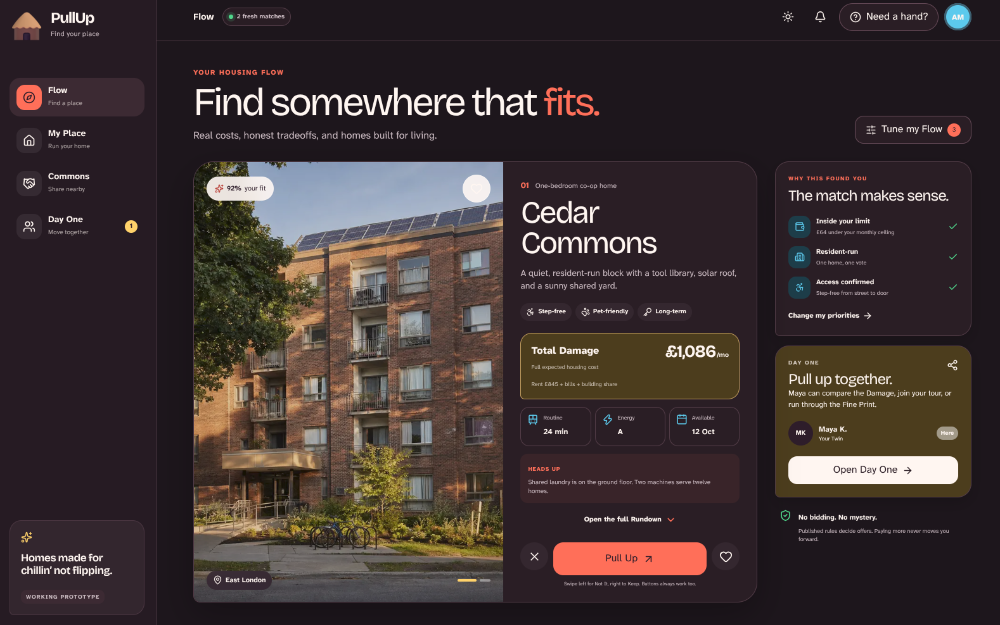
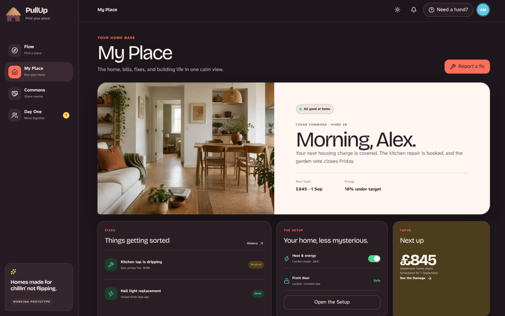
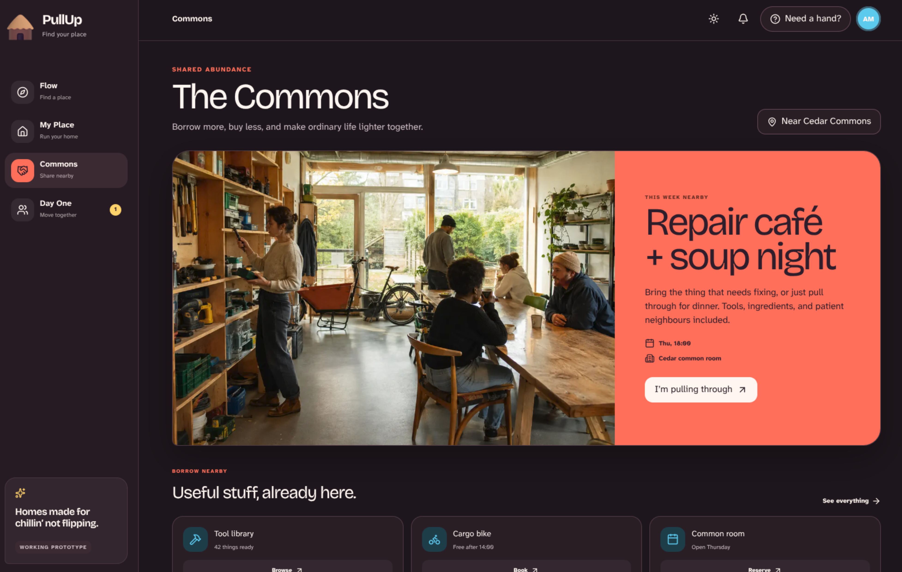
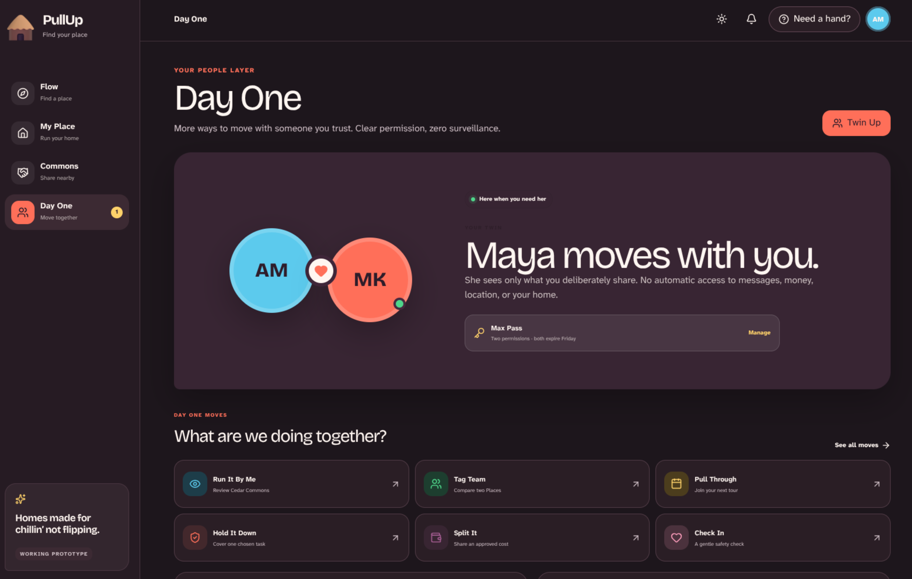

# PullUp

> Homes made for chillin’ not flipping.

**PullUp** is a public-benefit housing platform and membership network by **Sakia Labs**.

It helps everyday people find a suitable home, understand the full cost, apply once, move with less chaos, manage home life, share useful resources, and stay housed when circumstances change.

The experience feels warm and simple. The system underneath is serious: community land, cooperative and nonprofit ownership, cost-based housing, secure tenure, resident power, shared infrastructure, quiet intelligence, and climate-ready homes.

## See PullUp

The current prototype uses synthetic review data so the experience can be explored without implying that a real home, price, application, or service is live.

| Flow and The Rundown | My Place |
|---|---|
| [](docs/screenshots/web-flow.png) | [](docs/screenshots/web-my-place.png) |
| **Commons** | **Day One** |
| [](docs/screenshots/web-commons.png) | [](docs/screenshots/web-twin.png) |

## Why PullUp?

Most housing apps make searching easier without changing who owns the land, who sets the price, where the money goes, or how little power residents have after move-in.

PullUp connects the interface to a different operating model.

It learns from Red Vienna, modern Vienna, Finland’s housing-first system, Uruguay’s mutual-aid cooperatives, community land trusts, Catalonia’s right-to-use cooperatives, Germany’s Mietshäuser Syndikat, Canadian housing co-ops, cooperative energy, and digital public infrastructure.

Software alone cannot end housing extraction. PullUp combines technology with ownership, finance, law, governance, public capacity, and organizing.

## Core flow

1. Browse **Places** in the **Flow**.
2. **Keep** a Place, choose **Not It**, or **Pull Up** for a clear next step.
3. Read **The Rundown**.
4. See **Total Damage**, the full expected housing cost.
5. Open **Where It Goes** to understand the money.
6. Compare **Keepers** **Side by Side**.
7. Apply once with a reusable **Home Passport**.
8. Track **Where We At?**
9. Follow a private **Move Plan**.
10. Run home life through **My Place**.

Swiping is an optional browsing shortcut. Buttons, list, map, keyboard, screen reader, phone, print, kiosk, and human help are equal paths.

People may swipe on Places. PullUp never swipes on people.

## Product language

| Name | Meaning |
|---|---|
| **Flow** | Browse homes and rooms |
| **Places** | Homes and rooms |
| **Keepers** | Saved Places |
| **Pull Up** | Take a clear next step on a Place |
| **The Rundown** | Complete Place profile |
| **Total Damage** | Full expected housing cost |
| **Where It Goes** | Cost breakdown |
| **The Vibe** | Living and community character |
| **Heads Up** | Honest tradeoffs |
| **Word on the Block** | Verified resident insight |
| **The Backstory** | Repair and upgrade history |
| **Around Here** | Transit, services, and neighbourhood |
| **Home Passport** | Reusable resident-controlled application |
| **Fine Print** | Agreements, rights, and duties |
| **Where We At?** | Application status |
| **Move Plan** | Tour-to-move checklist |
| **My Place** | Resident home base |
| **The Setup** | Home systems and manuals |
| **Fixes** | Repairs |
| **Home Crew** | Household |
| **Ground Rules** | Shared expectations |
| **Commons** | Shared tools, rooms, mobility, energy, and resources |
| **The Board** | Building notices and decisions |
| **Damage Control** | Affordability and payment help |
| **Stay Put** | Housing stability |
| **Switch Up** | Transfer within the network |
| **My Business** | Privacy and permissions |
| **Day One** | Human-support mode across Sakia Labs |
| **Twin** | The one trusted person chosen inside Day One |
| **Need a Hand?** | The right guide, flow, Twin, or human support |

Fresh names never replace plain financial, legal, accessibility, or safety language. Serious actions remain **Apply**, **Sign**, **Pay**, **Withdraw**, and **Appeal**.

## The Sakia Labs connection

| Product or capability | Job |
|---|---|
| **PullUp** | Housing and home life |
| **fLOKr** | Community through Loops, Signals, Circles, Crews, Leads, Shifts, and Moves |
| **TapIn** | Shared action rail for approved payments, bookings, joining, reservations, confirmations, and temporary access |
| **Lexi** | Source-backed explanations of Fine Print, rights, forms, and deadlines |
| **Makana** | Private life transitions, wellbeing, goals, and LifeMaxxxin |
| **Day One** | Shared human-support layer with one chosen Twin and narrow permissions |

**Find your fLOKr. PullUp to your place. TapIn.**

PullUp owns housing truth. fLOKr owns community activity. TapIn executes approved actions. Lexi explains. Makana holds private reflection. Day One helps trusted people move together.

Social participation never affects housing access, price, repairs, rights, or tenure.

## Day One

Day One is not an AI clone, assigned stranger, roommate score, or paid advantage.

It lets a person **Twin Up** with one real person they trust, such as a friend, sibling, partner, parent, roommate, neighbour, advocate, or chosen family member.

| Move | What it does |
|---|---|
| **Twin Up** | Create the trusted connection |
| **Twin Mode** | Work together on selected things |
| **Tag Team** | Share a task or comparison |
| **Run It By Me** | Ask for a second look |
| **Put Me On** | Make a useful introduction |
| **Hold It Down** | Cover an approved task temporarily |
| **Double Tap** | Require both people to confirm |
| **Split It** | Share an approved cost through TapIn |
| **Pull Through** | Join a tour, event, or appointment |
| **Check In** | Run a chosen wellbeing or safety check |
| **Our Move** | Keep a shared plan |
| **Max Pass** | Grant narrow access with a purpose and expiry |
| **Receipts** | Show what was viewed, changed, or completed |

Every permission is granular, visible, expiring, and revocable. General finances, permanent keys, private messages, complete legal files, and Makana reflections are never shared by default.

Not using Day One never weakens someone’s housing access, rights, price, or service.

## Public-benefit model

PullUp is designed around:

- public or community control of land;
- cooperative, nonprofit, public, or mission-locked building ownership;
- cost-based housing charges;
- permanent affordability;
- secure tenure and due process;
- resident governance;
- paid technical assistance and substantial resident work;
- surplus returned to reserves, repairs, retrofits, services, affordability, and new homes;
- a federated service layer instead of one remote corporate landlord.

PullUp may earn revenue from partner software and service fees, implementation, training, shared procurement, facility support, and public-benefit contracts.

It does not earn from rent hikes, evictions, application fees, data sales, ads, paid listing boosts, or speculative appreciation.

## Solarpunk and the library economy

PullUp treats sustainability as daily infrastructure:

- repair before replacement;
- retrofit and reuse before demolition where feasible;
- healthy, efficient homes;
- solar, batteries, heat pumps, and shared energy where appropriate;
- tools, cargo bikes, guest rooms, studios, gardens, storage, and accessibility equipment through Commons;
- lower bills and waste;
- resident control of the benefits.

Shared access should create practical abundance, not forced austerity.

## Quiet intelligence

PullUp has no required AI mascot.

AI and data science may quietly improve recommendations, translation, document summaries, maintenance routing, forecasting, anomaly detection, energy systems, and fairness monitoring.

PullUp prohibits tenant scores, behaviour scores, social scores, automated housing rejection, eviction recommendations, dynamic housing prices, protected-trait inference, face-first roommate ranking, and hidden provider-paid ranking.

Material decisions require clear rules, reasons, human review, appeal, and fairness testing.

## Smart homes without a surveillance landlord

Useful connected systems may catch leaks, improve air, monitor equipment, lower energy costs, manage shared clean energy, and support accessibility.

PullUp does not use cameras or microphones inside homes, facial or emotion recognition, private-room occupancy inference, sensor-based discipline, data sales, or remote lockouts as punishment.

Physical, offline, and human fallbacks are required.

## Non-negotiables

- Housing comes before engagement.
- Total Damage comes before teaser price.
- Essential rights are never premium features.
- No paid boosts or fake urgency.
- No social participation in housing decisions.
- No surveillance as a condition of shelter.
- No autonomous AI judgment about housing.
- No private speculative exit from community-supported homes.
- No forced community or unpaid labour.
- Accessible online and offline routes.
- Local ownership with shared public-benefit infrastructure.

## Current technical proof

The repository includes one end-to-end, synthetic Place for reviewing the public experience without presenting fictional housing information as live. It covers **Flow**, **Pull Up**, **The Rundown**, **Total Damage**, **Where It Goes**, accessibility facts, sources, **My Place**, **Commons**, and **Day One**. It does not accept real applications, payments, bookings, or access requests.

The working slice uses a Next.js web app, a FastAPI modular monolith, a shared versioned Place fixture, PostgreSQL-ready persistence, a transactional outbox worker, and a generated TypeScript API client. Native mobile remains deliberately parked while the responsive web and PWA path is proven.

## Run locally

Requirements: Node.js 22.13 or newer, npm, Python 3.13 or newer, and [uv](https://docs.astral.sh/uv/). Docker is optional.

```bash
npm run bootstrap
npm run dev
```

Open [http://localhost:3000](http://localhost:3000). To run the API separately:

```bash
cd apps/api
uv run uvicorn pullup_api.main:app --reload --port 8000
```

Run the repository checks before committing:

```bash
npm test
```

For the containerized local stack:

```bash
./scripts/docker-up.sh
```

This starts the web app and API plus local-only PostgreSQL/PostGIS, Redis, S3-compatible object storage, MQTT, and captured email services. The object-storage console is at [http://localhost:9001](http://localhost:9001), and captured email is at [http://localhost:8025](http://localhost:8025).

## Documentation

### Start here

- [Documentation index](docs/README.md): the maintained map of project documents
- [Short concept](docs/project/concept.md): simple, shareable overview
- [Foundation](docs/project/foundation.md): mission, institutional model, economics, democracy, climate, pilot, and research
- [Product](docs/product/product.md): complete user experience, feature behaviour, integrations, safeguards, provider tools, and metrics
- [Manifesto](docs/project/manifesto.md): socioeconomic commitments and political purpose

### Build pack

- [Requirements](docs/project/requirements.md): functional requirements, quality requirements, launch gates, and non-goals
- [System design](docs/architecture/system-design.md): boundaries, data, permissions, events, failure modes, and deployment design
- [Technical stack](docs/architecture/tech-stack.md): selected technologies, version policy, architecture choices, and sources
- [Design system](docs/architecture/design-system.md): voice, colour, type, components, interaction, accessibility, and mockup direction
- [AI opportunity map](docs/project/ai-map.md): governed opportunities, prohibited uses, and the first synthetic proof
- [Roadmap](docs/project/roadmap.md): partnership gates, delivery phases, outcomes, and stop conditions
- [Tasks](docs/project/tasks.md): prioritized implementation backlog and completed proof tasks
- [Changelog](docs/project/changelog.md): short milestone history and current boundary

## Project status

**Current phase:** Pre-T0 planning plus a synthetic technical proof of selected Phase 1 and Phase 2 components.

The technical proof validates architecture and interaction choices; it is not a live housing service and does not imply that the roadmap's institutional gates have passed. Production implementation and real resident data begin only after:

- a pilot housing partner is committed;
- paid resident discovery validates the riskiest assumptions;
- legal, privacy, accessibility, security, and housing-policy owners accept their gates;
- the first sprint scope is approved.

## Recommended first proof

Start with one established co-op or nonprofit partner in London, Ontario, supporting roughly 50 to 150 existing homes.

The pilot should include paid resident advisors, legal and privacy review, accessible Place information, Total Damage, Fixes, Commons, The Board, narrow fLOKr and TapIn connections, Day One, and one small consent-based IoT use case.

Prove better service and stronger resident control before expanding.

## Technical direction

PullUp begins as a modular monolith with strong internal boundaries, not a microservice maze.

The planned stack uses a TypeScript web client, a Python service layer, PostgreSQL with spatial support, private object storage, an outbox-backed job system, standards-based observability, a progressive web app, and a local-first building gateway for optional IoT.

The [technical stack](docs/architecture/tech-stack.md) holds the authoritative version policy and decision record.

## Contributing

PullUp needs residents, housing workers, cooperative organizers, public servants, accessibility experts, legal clinics, privacy specialists, designers, engineers, repair teams, energy experts, and researchers.

Contributions should improve resident power or service, preserve permanent affordability, reduce administrative burden, respect privacy and accessibility, avoid extractive revenue, include evidence and lived experience, and keep serious housing information plain.

## Licensing direction

Recommended for legal review before public release:

- **Code:** AGPL-3.0-or-later
- **Documentation:** CC BY-SA 4.0
- **Names and marks:** Sakia Labs, PullUp, and related product marks remain separate from the open-source licenses

## Read next

Start with the [short concept](docs/project/concept.md), then read the [foundation](docs/project/foundation.md), [product](docs/product/product.md), and [manifesto](docs/project/manifesto.md). Builders can continue through the [requirements](docs/project/requirements.md), [system design](docs/architecture/system-design.md), and [roadmap](docs/project/roadmap.md).

**Built with 💖 for working people, chosen family, good neighbours, and everyone who deserves a place to breathe.**
