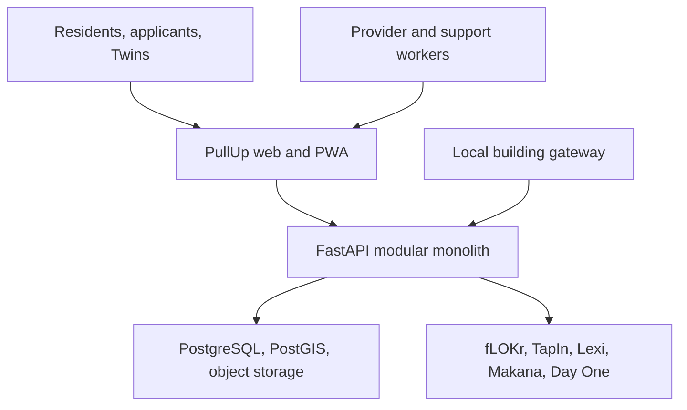
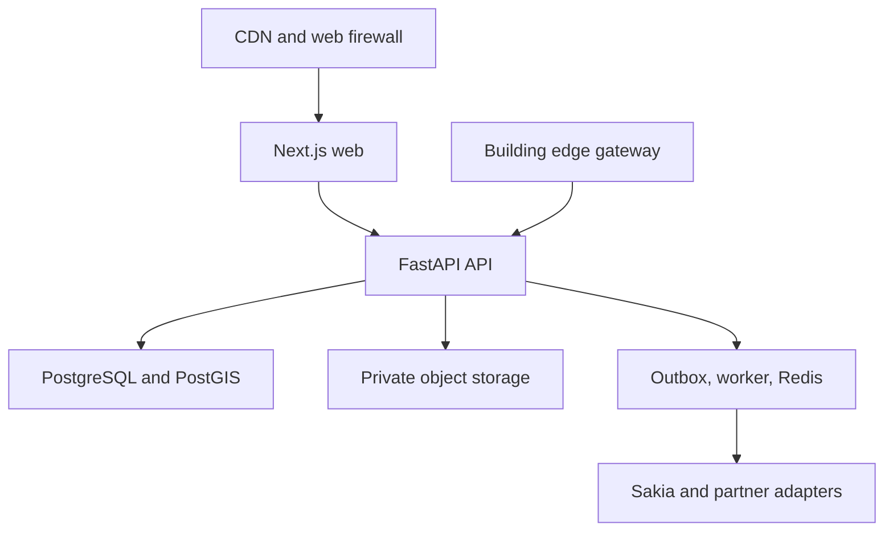
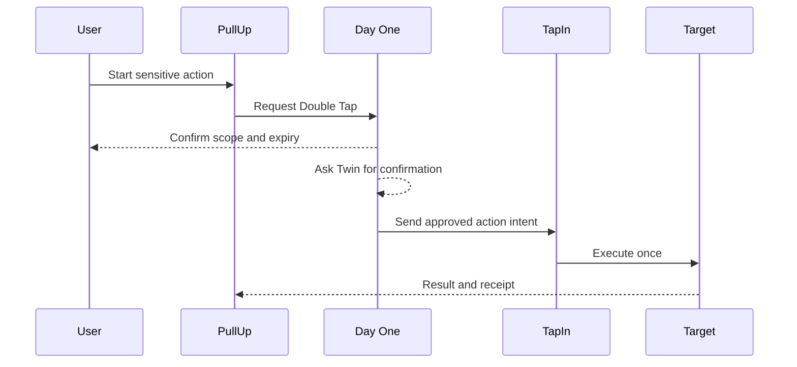

# PullUp System Design

**Version:** 1.0  
**Status:** Pilot architecture baseline  
**Date:** August 24, 2026  
**Related:** [requirements.md](../project/requirements.md), [tech-stack.md](tech-stack.md)

## 1. Design goal

Build one understandable housing platform that can safely serve a 50 to 150 home pilot and grow into a federation without handing resident power to a maze of services.

The system must:

- preserve housing, money, consent, repair, and access truth;
- keep Sakia Labs products independent but connected;
- support online, offline, assisted, and local-building routes;
- make every consequential action attributable and reviewable;
- make vendors replaceable;
- keep AI away from housing authority;
- degrade safely when an integration or the internet fails.

## 2. Architectural style

PullUp begins as:

- one Next.js web and PWA application;
- one FastAPI modular monolith;
- one PostgreSQL and PostGIS system of record;
- one worker deployment;
- one private object store;
- one Redis deployment for acceleration and queues;
- one local gateway per participating building or mechanical zone;
- typed API and event boundaries to other Sakia Labs products.

This is deliberately not a microservice launch.

The domain boundaries are real even when deployment boundaries are not. A module owns its data and policies. Other modules use a public service interface or a versioned event.

## 3. System context



### Trust statement

The browser is untrusted. Integrations are untrusted until authenticated and authorized. Building devices are untrusted until enrolled. Staff accounts are not trusted merely because they are staff. Every access is evaluated against identity, relationship, tenant, purpose, consent or authority, time, and resource.

## 4. Runtime topology



### Production placement

- Public web, API, worker, PostgreSQL, and confidential object storage run in contractually verified Canadian regions.
- Public static assets may use a global CDN.
- Database and storage are not public network endpoints.
- Staff administration requires strong identity and device controls.
- Local gateways keep essential building operation local.

## 5. Repository shape

```text
pullup/
  apps/
    web/
    api/
    worker/
  packages/
    ui/
    contracts/
    config/
  edge/
    gateway/
    simulator/
  infra/
    compose/
    opentofu/
  docs/
    adr/
    foundation.md
    product.md
    manifesto.md
    concept.md
    requirements.md
    system-design.md
    tech-stack.md
    design-system.md
    roadmap.md
    tasks.md
  scripts/
  README.md
```

The interactive design prototype lives as a separate review artifact until implementation begins.

## 6. Domain modules

| Module | Owns | Does not own |
|---|---|---|
| Identity | Accounts, assurance, sessions, scoped product subjects | Housing eligibility |
| Authorization | Roles, relationships, policies, decisions | Source business records |
| Consent | Grants, Max Pass, expiry, withdrawal, disclosure receipts | Legal basis definitions outside product policy |
| Providers | Organizations, staff assignments, service commitments | Resident identity |
| Places | Buildings, homes, rooms, availability, provider facts | Applications |
| Discovery | Flow, filters, Keep, Not It, Side by Side | Allocation |
| Costs | Total Damage, Where It Goes, charge versions | Payment execution |
| Applications | Home Passport packets, applications, status, reasons | Social participation |
| Allocation | Published eligibility and selection rules, decisions, appeal | Recommendation ranking |
| Agreements | Fine Print source documents, signatures, versions | Legal advice |
| Residents | Tenure, Home Crew, My Place relationships | Provider HR |
| Repairs | Fixes, work orders, appointments, outcomes | General social activity |
| Assets | The Setup, equipment, warranties, maintenance | Resident private behaviour |
| Commons | Resources, bookings, care, availability | General payments |
| Governance | The Board, proposals, budgets, decisions, ballots | Housing punishment |
| Stability | Damage Control, Stay Put, Switch Up | Automated eviction |
| Integrations | API clients, event publication, delivery receipts | Other products’ truth |
| IoT | Gateways, devices, normalized events, safe commands | Raw private-life surveillance |
| Audit | Append-only consequential activity and access records | Editable operational notes |
| Reporting | Approved aggregates, service and fairness metrics | Ad targeting |

## 7. Core data model

### 7.1 Scope hierarchy

The main ownership hierarchy is:

1. network;
2. provider;
3. building;
4. Place;
5. household or application;
6. record.

Every protected record carries the smallest relevant scope. Authorization does not infer scope from a URL alone.

### 7.2 Key entities

| Entity | Important fields |
|---|---|
| Network | id, mission policy, region, status |
| Provider | id, legal form, network, service commitments |
| Building | id, provider, address, safety classification |
| Place | id, building, unit or room, tenure, availability, accessibility |
| Cost version | Place, effective period, amount, currency, confidence, sources |
| Person | internal identity reference, assurance state |
| Household | Place or application context, membership, roles |
| Home Passport | owner, fields, documents, verification, retention |
| Application | Place, packet snapshot, status, rules version, reasons |
| Agreement | parties, source document, version, signatures, effective dates |
| Fix | Place, Setup asset, urgency, status, access window, outcome |
| Commons resource | building, type, state, booking policy |
| Governance item | scope, proposal, decision rule, outcome |
| Twin relationship | owner, Twin subject, status |
| Max Pass | product, resource, action, purpose, start, expiry |
| Day One receipt | actor, action, resource reference, result, time |
| TapIn intent | actor, action, resource, amount or entitlement, expiry |
| Device | gateway, asset, capability, privacy profile |
| Audit event | actor, purpose, policy, before, after, source, correlation |

### 7.3 Money

- Store integer minor units plus ISO currency.
- Store known and estimated items separately.
- Version every Total Damage calculation.
- Preserve the amount shown when a person applied or paid.
- Payment provider identifiers are references, not the system of record for housing obligations.
- No general stored-value wallet in the pilot.

### 7.4 Time

- Store event timestamps in UTC.
- Store relevant local timezone and jurisdiction.
- Preserve source date and effective date separately.
- Deadlines include the rule and calendar used to calculate them.

## 8. Authorization

Authorization combines:

- role-based controls for broad job function;
- attribute-based controls for provider, building, household, purpose, and time;
- relationship-based controls for resident, Twin, contractor, support worker, and governance role;
- PostgreSQL row-level security;
- application policy checks;
- explicit break-glass controls.

The [user roles](../product/user-roles.md) document defines the human meaning and product boundaries behind these authorization subjects. Implementation must preserve those distinctions rather than collapsing them into a broad staff or admin flag.

### Authorization decision

Every protected request answers:

1. Who is acting?
2. What assurance do they have?
3. What action do they want?
4. Which record and scope are involved?
5. What current relationship permits it?
6. For what purpose?
7. Is consent or another authority required?
8. Has access expired or been revoked?
9. What must be redacted?
10. What must be recorded?

### Break glass

Emergency or platform support access must:

- be narrow;
- be time-limited;
- require a reason;
- notify an accountable reviewer;
- create an immutable audit record;
- receive after-action review.

## 9. Day One design

Day One is one capability with a relationship graph of exactly one active chosen Twin per user in the pilot.

### 9.1 Separation

Day One stores the relationship and permission. It does not copy complete PullUp, fLOKr, TapIn, Lexi, or Makana records.

### 9.2 Max Pass

A Max Pass contains:

- owner subject;
- Twin subject;
- product;
- resource reference;
- allowed action;
- purpose;
- start;
- expiry;
- revocation state;
- optional one-use limit;
- created channel;
- policy version.

### 9.3 Moves

| Move | System operation |
|---|---|
| Twin Up | Create verified relationship after both people accept |
| Twin Mode | Open a permission-filtered shared workspace |
| Tag Team | Create task assignment and status |
| Run It By Me | Create a review request with selected material |
| Put Me On | Create a scoped share reference |
| Hold It Down | Create temporary delegated action |
| Double Tap | Require two confirmations before execution |
| Split It | Create approved TapIn cost shares |
| Pull Through | Send urgent practical request and delivery state |
| Check In | Share one user-selected signal |
| Our Move | Group shared tasks across authorized products |
| Max Pass | Issue, expire, or revoke permission |
| Receipts | Query relationship access and action history |

### 9.4 Double Tap flow



Double Tap never turns the Twin into a legal signer unless a separate lawful signing authority exists.

### 9.5 Revocation

Revocation:

- blocks new reads and writes immediately;
- invalidates active Max Pass tokens;
- cancels pending delegated actions where safe;
- preserves historical receipts;
- does not delete records another product must lawfully retain;
- notifies both people without exposing unrelated reasons.

## 10. TapIn design

TapIn is the shared action rail.

It handles:

- payment;
- booking;
- joining;
- reservation;
- confirmation;
- approved cost split;
- temporary access;
- entitlement execution.

### Action intent

A TapIn request contains:

- actor and product-scoped subject;
- action;
- target resource;
- amount and currency where applicable;
- purpose;
- expiry;
- idempotency key;
- required confirmations;
- callback contract.

TapIn returns a stable result and receipt. It does not decide housing eligibility or duplicate the Place, application, or community record.

## 11. Sakia Labs integration

### Ownership map

| Product | Owns |
|---|---|
| PullUp | Housing and resident operations |
| fLOKr | Community conversation and action |
| TapIn | Approved action execution |
| Lexi | Source-backed explanation workflows |
| Makana | Private wellbeing and life transitions |
| Day One | Trusted relationship, scope, delegation, and receipts |

### Integration rules

- No shared production tables.
- No universal circulating person identifier.
- Use scoped subject mapping.
- Use versioned OpenAPI for synchronous calls.
- Use JSON Schema or AsyncAPI for events.
- Put only the minimum data in an event.
- Include purpose and consent reference where relevant.
- Sign callbacks.
- Retry with idempotency.
- Dead-letter failed deliveries for review.
- An optional product failure must not block core repair or emergency routes.

### Event envelope

```json
{
  "event_id": "uuid",
  "event_type": "place.published.v1",
  "occurred_at": "RFC3339 timestamp",
  "producer": "pullup",
  "subject_id": "scoped opaque identifier",
  "purpose": "community_discovery",
  "consent_reference": null,
  "data": {}
}
```

## 12. API design

### Contract

- Prefix stable external contracts with /v1.
- Generate TypeScript clients from OpenAPI.
- Use cursor pagination.
- Use stable machine codes and plain-language messages.
- Use idempotency keys for consequential writes.
- Use record versions or ETags for collaborative updates.
- Require a reason for staff overrides.
- Never expose internal row identifiers when an opaque scoped identifier is appropriate.

### Representative resources

- /v1/places
- /v1/costs
- /v1/tours
- /v1/home-passports
- /v1/applications
- /v1/agreements
- /v1/residencies
- /v1/fixes
- /v1/assets
- /v1/commons
- /v1/governance
- /v1/stability
- /v1/day-one
- /v1/consents
- /v1/audit-receipts

Sensitive state transitions use explicit command endpoints when ordinary create or update semantics would hide their meaning.

## 13. Workflow and events

PostgreSQL owns workflow truth.

For a consequential change:

1. validate authorization and policy;
2. write the state change;
3. write the audit event;
4. write the outbox event;
5. commit one transaction;
6. let a worker deliver side effects;
7. record delivery state;
8. recover overdue work through scheduled scans.

Redis and workers improve speed. They do not become the legal record.

### Idempotency

Required for:

- payment;
- booking;
- application submission;
- agreement signing;
- Day One confirmation;
- access command;
- external callback.

## 14. Documents

### Upload

1. Request authorized upload slot.
2. Upload directly to quarantine.
3. Verify size and media type from content.
4. Scan for malware.
5. strip unnecessary metadata where appropriate;
6. create version and retention record;
7. move to private approved storage;
8. grant short-lived, purpose-specific access.

### Rules

- Public Place media is separate from confidential documents.
- Agreement versions are immutable.
- Home Passport shares point to selected versions.
- Download links expire.
- Storage access receives the same relationship and purpose checks as API data.
- Deletion follows retention and legal-hold rules, not a generic soft-delete flag.

## 15. Search and recommendation

Start with PostgreSQL full-text search, trigram matching, PostGIS, and explicit filters.

Place recommendation may rank by user-selected needs such as:

- cost;
- location;
- availability;
- tenure;
- accessibility;
- transport;
- household fit;
- selected living practices.

The service must:

- show why a Place appeared;
- allow filters to override recommendation;
- never use protected traits or proxies;
- never affect allocation;
- monitor result disparities;
- support chronological and list views.

Semantic retrieval is limited to approved Lexi sources, approved fLOKr content, and repair knowledge. It never ranks applicants.

## 16. AI boundary

Every model call passes through a provider-neutral gateway.

The gateway enforces:

- user and purpose;
- allowed data classes;
- approved sources;
- model and prompt version;
- structured output;
- timeout and cost limit;
- retention rule;
- human review rule;
- evaluation tag.

Models may recommend, summarize, translate, extract with review, route, forecast, or detect anomalies.

Models may not:

- allocate housing;
- set housing charges;
- reject an applicant;
- recommend eviction;
- control locks;
- infer protected traits;
- calculate resident worth;
- act on a payment or legal notice without deterministic policy and authorized confirmation.

## 17. Building edge

### Components

- managed Linux gateway;
- Home Assistant Core;
- Matter controller;
- Thread border router where needed;
- MQTT broker;
- BACnet or Modbus adapters;
- PullUp edge agent;
- encrypted short outage queue;
- device certificates;
- signed update channel.

Matter 1.6 readiness is preferred, but each device must be tested for its actual local behaviour and data path.

### Cloud boundary

Send normalized events:

- leak detected;
- equipment fault;
- air threshold exceeded;
- access system degraded;
- aggregate energy ready;
- device update required.

Do not send continuous audio, video, private-room occupancy, raw motion history, or high-resolution unit energy traces.

### Safe commands

Every remote command requires:

- authorized actor;
- approved purpose;
- building and device scope;
- expiry;
- idempotency;
- edge safety check;
- local acknowledgement;
- audit;
- manual fallback.

Billing state cannot revoke physical housing access.

## 18. Offline and low-bandwidth design

The PWA may cache:

- application shell;
- emergency contacts;
- building guide;
- selected Setup manuals;
- draft repair reports;
- safe draft application steps.

It must not cache confidential identity or legal documents without an explicit encrypted-device design.

Offline writes enter a local outbox only when the action is safe and idempotent. The interface shows pending, sent, failed, and retry states.

## 19. Observability

OpenTelemetry spans web, API, worker, integration, and gateway activity with a common correlation identifier.

### Allowed operational signals

- request rate, error, and latency;
- queue depth and age;
- database health;
- integration delivery;
- application and repair timers;
- gateway health;
- accessibility and client errors without session replay.

### Never log by default

- identity documents;
- agreement text;
- payment details;
- credentials;
- resident free text;
- precise private sensor history;
- Makana reflections;
- Lexi questions;
- Home Passport content.

## 20. Security controls

The pilot targets OWASP ASVS 5.0 Level 2, with stronger controls for:

- authentication;
- confidential documents;
- payments;
- digital signatures;
- physical access;
- privileged administration.

Required controls include:

- multi-factor authentication for staff;
- short-lived sessions and token rotation;
- server-side authorization;
- row-level security;
- secrets management;
- dependency and container scanning;
- upload quarantine;
- rate limiting;
- web firewall;
- encryption in transit and at rest;
- tamper-evident audit records;
- tested backup and restore;
- incident response.

## 21. Failure modes

| Failure | Safe behaviour |
|---|---|
| fLOKr unavailable | Housing, repairs, applications, and The Board continue |
| Lexi unavailable | Original documents and human-help routes remain |
| Makana unavailable | PullUp continues and sends no private-data request |
| Day One unavailable | User can complete their own core tasks |
| TapIn payment unavailable | No duplicate charge, clear pending state, human route |
| TapIn access unavailable | Physical or staffed fallback remains |
| Redis unavailable | Core workflow persists, noncritical work waits |
| Worker unavailable | Outbox accumulates and alerts |
| Internet unavailable | Local building controls and physical access continue |
| Gateway unavailable | Manual building operation continues and alerts |
| Model unavailable | Deterministic product continues without fake answers |
| Database failover | Writes pause safely, recover from verified state |

## 22. Scaling triggers

Do not split a module into a service because the diagram looks grown-up.

Consider extraction only when:

- an independent team owns the domain;
- load or availability differs materially;
- regulatory isolation requires it;
- deployment frequency conflicts;
- a measured database or queue boundary exists;
- the extraction lowers total risk.

Likely later candidates are notifications, document processing, integration delivery, and IoT fleet management. Housing allocation and consent should remain close to the core until a strong reason proves otherwise.

## 23. Architecture decisions to record

1. Modular monolith and extraction criteria.
2. Resident, provider, support, and Day One authorization.
3. Allocation firewall from discovery and AI.
4. Consent ledger and product-scoped identity.
5. Canadian data residency and vendor review.
6. Confidential document handling.
7. Transactional outbox.
8. Flow accessibility.
9. TapIn action intent.
10. Day One Max Pass and Double Tap.
11. Local-first IoT and prohibited sensing.
12. Door access separation from billing.
13. Lexi authority and abstention.
14. Export and provider portability.

## 24. Acceptance

The design is ready to implement when:

- module ownership is accepted;
- the provider’s real workflows map to the modules;
- the identity and Max Pass model passes legal and privacy review;
- Total Damage has a stable schema;
- allocation rules can be represented without AI;
- the non-app fallbacks have accountable owners;
- residency and storage contracts are approved;
- the pilot threat model is reviewed;
- the roadmap references requirement IDs;
- no critical journey depends on an optional Sakia Labs product.

---

Built with 💖 for a system that stays understandable even when the mission gets big.
