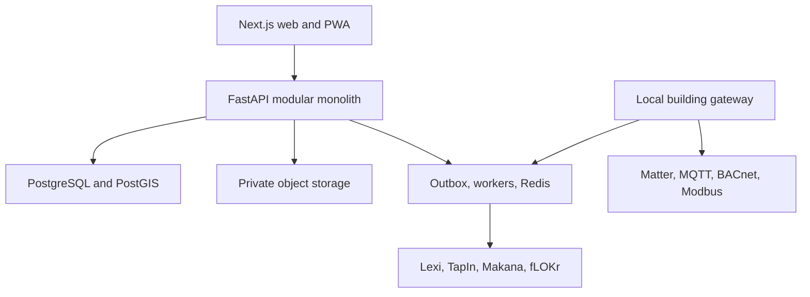

# PullUp Technical Stack

**Version:** 1.0  
**Prepared:** August 24, 2026  
**Decision:** Build a modular monolith, local-first building gateway, and typed event boundaries. Optimize for resident safety, team speed, Canadian deployment, accessibility, and the ability to replace vendors.

## 1. Stack in one table

| Layer | Decision | Why it fits PullUp |
| --- | --- | --- |
| Web | Latest security-patched Next.js 16 Active LTS, React, TypeScript | Strong server-rendered experience, accessible web reach, installable PWA path, and one codebase for resident and operator surfaces |
| Styling and UI | Tailwind CSS 4, shadcn/ui, Radix primitives, Motion | Fast branded interface work with accessible primitives and optional Flow gestures |
| Forms and validation | React Hook Form and Zod | Long, resumable housing forms need predictable validation and good performance |
| Client data | Server Components first, TanStack Query where live client state is necessary | Prevents a global-state mess while supporting repairs, tours, and live statuses |
| API | FastAPI, Pydantic, SQLAlchemy, Alembic | Typed Python, OpenAPI, excellent validation, and a clean home for housing, AI, data, and operations logic |
| Database | PostgreSQL with PostGIS | Transactions, policy controls, auditability, search, geospatial queries, and portability |
| Identity | Supabase Auth | Passwordless, OTP, social, and standards-aligned authentication with Postgres integration |
| Authorization | PostgreSQL row-level security plus application policy checks | Defense in depth across residents, helpers, staff, providers, and auditors |
| Files | S3-compatible private storage in a contractually verified Canadian region | Sensitive housing documents need residency, encryption, controllable access, and vendor portability |
| Maps | MapLibre GL JS | Open-source vector maps without a proprietary map-rendering lock-in |
| Search | PostgreSQL full-text and trigram search, pgvector only for semantic retrieval | One source of truth first, specialized vector use only when justified |
| Jobs | Transactional outbox, Celery, Redis | Reliable domain event publication and practical background processing |
| Realtime | Server-Sent Events first, WebSockets only for true two-way live interaction | Simpler infrastructure for status feeds and notifications |
| IoT edge | Home Assistant Core, Matter controller, MQTT, Thread, BACnet or Modbus bridges | Local operation, broad device integration, open standards, Matter 1.6 readiness, and legacy-building compatibility |
| AI | Provider-neutral model gateway, retrieval from approved sources, structured outputs, and evaluation suite | Lexi and quiet intelligence can improve without giving a model authority over housing decisions |
| Observability | OpenTelemetry, Prometheus-compatible metrics, Grafana, error tracking | Vendor-neutral traces, metrics, and logs with privacy filtering |
| Infrastructure | Docker Compose, GitHub Actions, OpenTofu or Terraform, Canadian-region container and Postgres hosting | Reproducible development, auditable delivery, and a data-residency path |
| Quality | Pytest, Vitest, Playwright, axe-core, Ruff, mypy, ESLint, TypeScript strict mode, OWASP ASVS 5.0 | Tests product behavior, accessibility, contracts, security, and domain rules |

## 2. Architectural position

### 2.1 Choose a modular monolith

The MVP should have separately owned modules inside one deployable API and one primary PostgreSQL database.

This is not a shortcut. It is the correct fit for a small team dealing with transactions that cross homes, applications, agreements, charges, repairs, access, and audit records.

Benefits:

- One transaction can update a repair and its audit event safely.
- Local development remains understandable.
- Authorization and consent are easier to test.
- Operational cost stays sane during a one-building pilot.
- Domain boundaries can be extracted later if measured load or ownership requires it.

Do not begin with Kubernetes, a service mesh, Kafka, twenty databases, or separate services for every noun.

### 2.2 Use domain modules, not folders named “utils”

Recommended backend modules:

```text
identity
households
consent
homes
discovery
applications
allocation
agreements
billing
repairs
assets
commons
governance
community
support
iot
audit
reporting
```

Each module owns its models, commands, queries, policies, API routes, events, and tests. Another module uses its public service interface or an event, not a casual table write.

### 2.3 High-level topology



The gateway sends minimum necessary events. It does not stream raw life inside a home to the main platform.

## 3. Web application

### 3.1 Next.js App Router

Use the latest security-patched Next.js 16 Active LTS release and its App Router. Next.js announced an August 26, 2026 security release for the 16.3 and 15.5 lines, so implementation must begin after applying that patch rather than pinning today’s pre-advisory build. The [official App Router documentation](https://nextjs.org/docs/app) covers layouts, navigation, and server and client component patterns.

Rules:

- Server-render public Place and policy pages.
- Use Server Components for read-heavy screens that do not require browser state.
- Use Client Components only at interaction boundaries such as Flow gestures, map controls, forms, Day One collaboration, and device setup.
- Keep domain access behind the FastAPI contract. Do not grow a second housing backend inside route handlers.
- Use route handlers only for web-specific concerns such as secure session exchange, lightweight proxying, and platform callbacks.
- Make every core route usable at 200 percent zoom and on a narrow screen.

### 3.2 TypeScript

- Enable strict mode.
- Generate types and API clients from the FastAPI OpenAPI document.
- Avoid manual duplication of request and response schemas.
- Treat money as integer minor units plus currency, never floating point.
- Treat dates, times, and legal deadlines as explicit types with timezone and source.
- Use tagged unions for status transitions.

### 3.3 UI system

Use Tailwind CSS for tokens and composition, shadcn/ui as owned source code, and accessible primitives such as Radix where they fit.

The design system needs:

- Color, type, spacing, radius, elevation, and motion tokens
- High-contrast and low-stimulation themes
- Large controls with a 44 by 44 pixel preferred interaction target
- Focus states that never disappear
- Reduced-motion alternatives
- Plain-language form components
- Cost, tenure, access, source, status, and warning patterns
- Skeletons that do not cause layout movement
- Print styles for agreements, decisions, receipts, and repair histories

### 3.4 Flow implementation

Use pointer events and Motion for card feedback, but keep the state transition independent of the gesture.

```text
Keep button   -> keepPlace command
Right swipe   -> keepPlace command
Not It button -> passPlace command
Left swipe    -> passPlace command
Pull Up button -> openTour command
Up swipe      -> openTour command
```

That design ensures keyboard, switch, voice, eye-gaze, touch, and mouse users reach the same outcome. [WCAG 2.2 dragging guidance](https://www.w3.org/WAI/WCAG22/Understanding/dragging-movements.html) requires a non-drag single-pointer alternative.

Other rules:

- The card remains in the DOM long enough for assistive technology to receive the result.
- Announce action and undo through a polite live region.
- Do not bind a decision to motion before pointer-up.
- Respect `prefers-reduced-motion`.
- Store Not It locally or privately server-side. Do not expose it to providers.
- Use a finite deck and cursor pagination.
- Cache a small next batch, not an endless feed.

### 3.5 Forms

Use React Hook Form with Zod schemas generated or aligned with API contracts.

- Save drafts automatically.
- Support step-by-step and full-form views.
- Preserve values across translation and session recovery.
- Validate accessibly on blur and submission, not on every keystroke.
- Use explicit error summaries with focus management.
- Never require a drag, timed interaction, or document-camera capture.
- Make uploads replaceable and inspectable before submission.

### 3.6 State and realtime

- URL state for filters, modes, and shareable comparisons.
- Server Components for initial data.
- TanStack Query for interactive server state such as repairs, tours, and bookings.
- Local component state for ephemeral gestures.
- Server-Sent Events for status streams and the Loop.
- WebSockets only for a later feature that truly needs two-way continuous communication.

Avoid Redux unless a measured cross-application state problem appears.

### 3.7 PWA, offline, and low bandwidth

The web app is the primary product. Wrap or add native clients only after pilot evidence.

PWA capabilities:

- Installable shell
- Cached building guide, contact, and emergency information
- Draft repair reports and application steps
- Background retry for safe idempotent actions
- Push notifications with SMS and print alternatives
- Offline access credentials only through a separately secured mechanism

Never cache highly sensitive legal or identity documents without explicit encrypted-device design.

## 4. API and domain logic

### 4.1 FastAPI

[FastAPI](https://fastapi.tiangolo.com/) uses Python type hints, Pydantic validation, OpenAPI, and generated interactive documentation. It is a strong fit for PullUp's typed domain and future AI and analytics work.

Use:

- Python 3.13 or newer supported release
- FastAPI
- Pydantic v2
- SQLAlchemy 2.x
- Alembic
- Uvicorn workers behind a managed ingress
- `uv` for Python dependency and environment management

### 4.2 API conventions

- Prefix public contracts with `/v1`.
- Use resource nouns and explicit commands when a transition carries business meaning.
- Require idempotency keys for payment, application, agreement, booking, and device-command writes.
- Return stable machine codes plus plain-language messages.
- Expose an OpenAPI document for generated clients.
- Use cursor pagination.
- Use ETags or version fields for collaborative records.
- Require a reason for staff overrides.
- Record actor, purpose, policy, before, after, and source for consequential changes.

### 4.3 Workflow truth lives in PostgreSQL

Legal deadlines, applications, repairs, payments, and access commands must not exist only in Redis or a job queue.

- Store the workflow record and next action in PostgreSQL.
- Write its domain event to an outbox in the same transaction.
- A worker publishes or processes the outbox entry.
- Consumers use idempotency and deduplication.
- Scheduled recovery scans find missed or overdue work.

Redis accelerates. It does not become the legal system of record.

### 4.4 Background work

Use Celery with Redis for:

- Document scanning and conversion
- Notification fan-out
- Search indexing
- Approved AI extraction and summarization
- Noncritical analytics aggregation
- IoT event normalization
- Scheduled reminders

Use PostgreSQL advisory locks or unique work claims where exact-once business effect matters. A task queue may deliver more than once.

## 5. Data platform

### 5.1 PostgreSQL

The current [PostgreSQL documentation](https://www.postgresql.org/docs/current/) is the primary technical source. PostgreSQL supplies transactions, constraints, JSON where appropriate, full-text search, partitioning, row-level security, and a mature operational ecosystem.

Design rules:

- Normalize core rights, money, status, consent, and audit records.
- Use JSONB for provider-specific extensions and versioned payloads, not as an excuse to avoid modeling.
- Use UUIDv7 or time-sortable identifiers where supported by the chosen libraries.
- Store money in minor units and currency.
- Store timestamps in UTC and the relevant local timezone or jurisdiction context.
- Use database constraints for impossible states.
- Use append-only decision and audit records.
- Soft deletion is not a substitute for a real retention policy.

### 5.2 PostGIS

[PostGIS](https://postgis.net/documentation/) adds geospatial types and indexes.

Use it for:

- Distance to transit, health, school, care, food, and community services
- Accessible-route datasets when a reliable source exists
- Provider and service catchments
- Building and parcel analysis
- Climate and hazard overlays

Do not expose a resident's precise current location to providers or community groups.

### 5.3 Search

Start with:

- PostgreSQL full-text search
- `pg_trgm` for tolerant matching
- Materialized search documents for public Places and policy content
- Permission-filtered legal and community retrieval

Add pgvector only for:

- Lexi retrieval over approved, versioned sources
- Permission-filtered semantic retrieval over approved fLOKr community content
- Similar repair knowledge articles

Vector similarity never drives resident allocation.

### 5.4 Multitenancy

Use one logical platform with `provider_id` and `building_id` scopes, PostgreSQL row-level security, and application authorization.

- Residents see their household and explicitly shared community content.
- Delegated helpers receive narrow, expiring permissions.
- Building staff see only assigned buildings and job-relevant data.
- Provider staff see only their organization.
- Network analysts receive approved aggregate or de-identified data.
- Platform engineers need break-glass, time-limited, logged access.

[Supabase's RLS guidance](https://supabase.com/docs/guides/database/postgres/row-level-security) is the baseline, but application policy tests remain mandatory. Service credentials that bypass RLS must never reach the browser.

## 6. Identity, consent, and authorization

### 6.1 Supabase Auth

[Supabase Auth](https://supabase.com/docs/guides/auth) supports passwords, magic links, one-time passwords, social login, SSO, JWTs, and integration with PostgreSQL authorization.

Initial methods:

- Email magic link or OTP
- Phone OTP where risk and delivery reliability are acceptable
- Password plus strong recovery for residents who prefer it
- Passkeys as the preferred long-term method
- SSO for approved provider staff
- Recovery codes and staffed identity recovery

Do not require a social login provider.

### 6.2 Identity assurance is contextual

Browsing public Places requires no account. Saving locally can begin anonymously.

Higher assurance is introduced only when needed:

- Private Shortlist sync: basic account
- Application: verified contact and jurisdiction-appropriate identity process
- Agreement signing: stronger verification
- Staff access: phishing-resistant MFA
- Building or unit access: device-bound credential plus fallback

### 6.3 Authorization model

Combine:

- RBAC for broad roles
- ABAC for provider, building, household, purpose, relationship, and time
- Relationship checks for residents, helpers, contractors, and case workers
- PostgreSQL RLS for data-layer enforcement
- Policy tests as code

An authorization decision should answer:

```text
Who is acting?
What do they want to do?
Which resident, household, building, or provider is involved?
For what approved purpose?
Is the relationship current?
Is consent or legal authority present?
What must be logged or redacted?
```

### 6.4 Consent ledger

Store a versioned record of:

- Data fields
- Purpose
- Recipient or integration
- Granting actor and authority
- Start and expiry
- Withdrawal
- Legal basis where consent is not the basis
- Downstream event status

Consent cannot legalize an unfair housing practice or waive a non-waivable right.

## 7. Documents and media

Use private S3-compatible object storage in a contractually verified Canadian region. Supabase Storage in Canada Central is acceptable for the pilot when its contract, retention, backup, and subprocessor terms pass review. Keep the storage interface portable so another S3-compatible Canadian service can replace it.

Rules:

- Private buckets by default
- Short-lived signed upload and download URLs
- Tenant and purpose encoded in server-side metadata
- Malware scanning before a file becomes available
- File-type verification from content, not extension
- Image metadata stripping
- Resident-controlled alternative text or description
- Versioning for agreements and decision records
- Retention and legal-hold rules
- Separate public media from confidential documents
- Encryption keys and access policy outside client control

Keep a storage adapter so the provider can be replaced without rewriting domain logic.

## 8. Maps and location

Use [MapLibre GL JS](https://maplibre.org/maplibre-gl-js/docs/) for web maps and PostGIS for server-side location queries.

- Use a commercial, municipal, or self-hosted tile service with clear licensing and capacity.
- Do not rely on the public OpenStreetMap tile server for production traffic.
- Provide a full list equivalent to every map result.
- Do not place sensitive supportive-housing or shelter locations on a public map without safety review.
- Round or generalize location where exact disclosure creates risk.
- Keep accessibility claims source-specific and dated.

## 9. Sakia Labs integrations

### 9.1 Pattern

Integrations use versioned APIs and events, not shared database tables.

- PullUp owns housing truth.
- fLOKr owns community conversation and action.
- Lexi owns sourced explanation workflows.
- TapIn owns approved action execution for payments, bookings, joining, reservations, confirmations, and temporary access.
- Makana owns private wellbeing and transition data.
- Day One owns the trusted relationship, scoped delegation, shared plans, two-person confirmation, and receipts.

### 9.2 Contracts

Keep JSON Schema or AsyncAPI event definitions in `packages/contracts`.

Required envelope fields:

```json
{
  "event_id": "uuid",
  "event_type": "place.published.v1",
  "occurred_at": "RFC3339 timestamp",
  "producer": "pullup",
  "subject_id": "opaque scoped identifier",
  "purpose": "community_discovery",
  "consent_reference": "optional opaque identifier",
  "data": {}
}
```

Never place an entire resident or application object in an event.

### 9.3 Identity linking

Use an internal identity broker or scoped subject mapping. Do not assume the same database identifier should circulate across the product family.

The user sees one account and consent dashboard. Each service sees only the scoped identity it needs.

### 9.4 TapIn and Day One boundaries

TapIn is a shared capability, not a shared database. A calling product sends an approved action intent. TapIn validates the actor, amount or resource, purpose, expiry, idempotency key, and required confirmation before execution.

Day One is also a shared capability. It stores:

- the Twin relationship;
- Max Pass scope and expiry;
- Tag Team assignments;
- Our Move references;
- Double Tap confirmation state;
- Split It authorization references;
- Check In preferences;
- Receipts.

Day One stores references to PullUp, fLOKr, Lexi, TapIn, or Makana records rather than copying the private records. A Max Pass grants the minimum action, not general product access.

## 10. IoT and building edge

### 10.1 Edge gateway

Deploy a small managed Linux gateway per building or mechanical zone.

Recommended components:

- Home Assistant Core for supported integrations and local automation
- Matter Server for compatible devices
- Thread border router where needed
- Eclipse Mosquitto or another standards-compliant MQTT broker
- BACnet or Modbus adapter for building equipment
- PullUp edge agent for policy, buffering, health, and event normalization
- Encrypted local storage for short outage queues
- Device certificate and remote-update channel

The [Matter standard overview](https://csa-iot.org/all-solutions/matter/) describes an IP-based interoperability protocol. [Home Assistant's Matter integration](https://www.home-assistant.io/integrations/matter/) provides a practical reference for local control. [MQTT](https://mqtt.org/) provides lightweight publish and subscribe messaging.

### 10.2 Cloud boundary

Cloud receives events such as:

```text
leak.detected
equipment.fault
air.threshold.exceeded
access.system.degraded
energy.aggregate.ready
device.update.required
```

Cloud should not receive continuous audio, video, room occupancy, raw motion history, or minute-by-minute unit energy traces unless a narrow life-safety or resident-approved use has passed privacy review.

### 10.3 Commands

Remote commands require:

- Authorized actor and purpose
- Building and device scope
- Idempotency key
- Expiry
- Safety policy at the edge
- Local acknowledgement
- Audit record
- Manual fallback

Door access cannot be revoked by a general billing workflow. Housing enforcement and physical access are separate high-risk domains.

### 10.4 The Setup asset model

Use a relational asset register first:

- Building, floor, room, system, asset, and component hierarchy
- Model, serial, installation, warranty, and inspection data
- Manuals and approved procedures
- Sensors and control points
- Work orders, faults, parts, and costs
- Energy and carbon attributes

Add graph or time-series technology only when a measured query or retention need exceeds PostgreSQL.

## 11. AI platform

### 11.1 Architecture

Use a model gateway behind FastAPI with adapters for approved providers.

Every AI feature declares:

- User and purpose
- Allowed data classes
- Approved source collections
- Prompt and model version
- Required output schema
- Confidence or abstention behavior
- Human review rule
- Retention policy
- Evaluation suite

### 11.2 Retrieval

Lexi retrieval must filter by:

- Jurisdiction
- Document authority
- Effective date
- Language
- Agreement or notice type
- User permissions

Answers include source, date, uncertainty, and next step. A missing authoritative source causes abstention or human escalation.

Quiet community retrieval uses only public or explicitly approved fLOKr content. It cannot see legal files, applications, payments, unit access, Day One scopes, or Makana reflections.

### 11.3 Model boundaries

- No model in allocation.
- No model-generated housing charge.
- No “tenant quality,” vulnerability, fraud, emotion, or behaviour score.
- No protected-trait inference.
- No model action on locks, life-safety systems, payments, or legal notices without deterministic policy and authorized confirmation.
- No training on resident data unless a separate lawful, explicit, revocable program is established.

### 11.4 Evaluation

Maintain tests for:

- Citation correctness
- Jurisdiction and date accuracy
- Hallucination and abstention
- Plain-language quality
- Translation fidelity
- Differential quality across languages and accessibility needs
- Leakage between households or providers
- Prompt injection from uploaded documents or community content
- Tool authorization and side effects

## 12. Observability and analytics

[OpenTelemetry](https://opentelemetry.io/docs/) is a vendor-neutral framework for traces, metrics, and logs. Instrument the web app, API, workers, integrations, and edge agent with a common correlation ID.

### 12.1 Operational signals

- Request rate, error rate, and latency
- Queue depth and outbox age
- Notification and integration failure
- Database saturation and slow queries
- Storage scan delay
- Edge-gateway health and event backlog
- Repair and application service-level timers
- Accessibility and client-error telemetry without session replay

### 12.2 Privacy filters

Never log:

- Agreement text
- Identity documents
- Payment details
- Access tokens or credentials
- Resident free-text by default
- Exact unit-level sensor history
- Makana reflections
- Lexi questions without an approved redaction path

Use structured allowlists, not a hope that engineers remember to redact.

### 12.3 Product analytics

Use first-party, privacy-respecting event collection with no advertising identifier or third-party replay script.

Measure tasks and outcomes, such as:

- Place card viewed
- Cost details opened
- Accessible alternative used
- Shortlist created
- Comparison completed
- Application resumed
- Repair reopened
- Commons item borrowed

Do not measure “engagement” as a goal by itself. The best session may be a thirty-second repair check.

## 13. Deployment and infrastructure

### 13.1 Environments

| Environment | Purpose | Data rule |
| --- | --- | --- |
| Local | Development and simulated building | Synthetic data only |
| Preview | Pull-request review | Synthetic or generated fixtures only |
| Staging | Integration, accessibility, performance, and operator acceptance | De-identified or synthetic data |
| Production | Real resident and building operations | Approved region, contract, policy, and access controls |

### 13.2 Local development

Docker Compose runs:

- PostgreSQL with PostGIS
- Supabase-compatible local Auth services
- Redis
- S3-compatible storage emulator
- FastAPI
- Celery worker
- Next.js
- MQTT broker
- Simulated edge agent and devices
- Mail and SMS capture

Use root npm scripts as the human-facing command layer. Use npm workspaces for TypeScript packages and `uv` for Python.

### 13.3 Production hosting

Sensitive Canadian resident data should run in a contractually verified Canadian region.

Recommended production shape:

- Containerized Next.js, FastAPI, and workers on a Canadian-region managed container service
- Managed PostgreSQL with PostGIS, point-in-time recovery, encryption, and private networking
- Managed Redis with no legal system of record
- Private S3-compatible storage in Canada Central after contractual, retention, recovery, and subprocessor review for each data class
- CDN and web application firewall for public assets and ingress
- Private operator access with strong identity and device controls
- Infrastructure as code

Supabase managed hosting is approved only if its selected region and contract meet the deployment's residency, privacy, recovery, and subprocessor requirements. The application must remain portable to a standard PostgreSQL deployment.

### 13.4 Infrastructure as code

Use OpenTofu or Terraform modules for:

- Networks and ingress
- Container services
- PostgreSQL and Redis
- Object storage policy
- Secrets and keys
- Monitoring and alerting
- Backups
- DNS and certificates
- CI deployment identity

No production resource should depend on a console-only setup nobody can reproduce.

## 14. CI, testing, and release safety

### 14.1 Pull-request checks

- TypeScript type check
- ESLint and formatting
- Ruff and mypy
- Unit and domain-policy tests
- API contract diff
- Database migration checks
- Component accessibility tests
- Playwright critical journeys
- Dependency and secret scan
- Container vulnerability scan
- Infrastructure validation

### 14.2 Critical journey tests

- Browse and compare a Place without an account
- Save and undo by button, keyboard, and swipe
- Complete a Home Passport with a screen reader
- Grant and revoke helper access
- Submit and resume an application
- Review an agreement with sources
- Make a payment and receive a receipt
- Submit, escalate, and reopen a repair
- Book and unlock a Commons item
- Join or mute a Circle
- Continue a safe building flow during internet loss

### 14.3 Policy tests

Write executable tests for statements such as:

- A provider cannot see a resident's Pass history.
- A fLOKr Lead cannot see an application.
- Makana data cannot be queried by housing staff.
- A contractor sees only the assigned repair and approved access window.
- A service credential cannot list all providers without an explicit platform audit scope.
- An expired helper cannot access new documents.
- A failed payment cannot issue a door-lock command.
- A unit sensor event cannot influence allocation.

### 14.4 Release strategy

- Trunk-based development with short-lived branches
- Database expand-and-contract migrations
- Feature flags that never bypass authorization
- Canary rollout for operators and volunteer pilot residents
- Edge gateway staged updates with rollback
- Backward-compatible event consumers during transition
- Incident playbooks and public status communication

## 15. Repository structure

```text
pullup/
  apps/
    web/
    api/
    worker/
  packages/
    ui/
    contracts/
    config/
  edge/
    gateway/
    simulator/
  infra/
    compose/
    terraform/
  docs/
    adr/
    concept.md
    product.md
    tech-stack.md
  scripts/
  .github/
    workflows/
  README.md
```

## 16. Important architectural decision records

Create these ADRs before implementation:

1. Modular monolith and extraction criteria
2. Resident, provider, and delegated-helper authorization model
3. Allocation firewall from discovery and AI
4. Consent ledger and product-family identity mapping
5. Canadian data residency and vendor approval
6. Document storage, malware scanning, and retention
7. Transactional outbox and event contracts
8. Flow accessibility and anti-dark-pattern rules
9. Local-first IoT and prohibited sensing
10. Door access separation from billing and enforcement
11. Lexi source authority and abstention
12. Public API, export, and provider portability

## 17. Alternatives rejected for now

| Alternative | Why not now | Revisit when |
| --- | --- | --- |
| React Native first | Splits effort before the web experience and assisted routes are proven | Device integration or offline field evidence clearly requires native |
| GraphQL everywhere | Adds schema and cache complexity without a proven client need | Multiple complex clients need flexible joined reads |
| Microservices | Raises operational and consistency cost | Independent teams or load boundaries are measured |
| Kubernetes | Too much platform overhead for a building pilot | Fleet, availability, and deployment scale justify it |
| Kafka | Outbox, Postgres, and Redis cover initial event volume | Retention, replay, throughput, or team ownership requires a log |
| Separate search cluster | Postgres search is adequate and permission-aware | Search scale or relevance becomes a measured constraint |
| Blockchain or housing token | Adds speculation, custody, governance, and legal risk without solving ownership | Do not revisit for core housing rights |
| Proprietary smart-home cloud | Creates lock-in and exposes intimate telemetry | Only for a narrowly reviewed device with a local fallback |
| Session replay analytics | High privacy risk in legal, housing, and payment flows | Prefer never; use targeted usability studies and synthetic replay |

## 18. Definition of technically ready for the roadmap

The stack is ready to sequence when the team accepts these decisions:

- Next.js web and PWA, not native-first
- FastAPI modular monolith, not microservices
- PostgreSQL and PostGIS as system of record
- Supabase Auth with a production residency gate
- Canadian-region object storage behind a portable S3 adapter and policy gate
- OpenAPI and typed event contracts between the product family
- Transactional outbox plus Celery and Redis
- Flow with equivalent controls and an allocation firewall
- Local building gateway using Matter, MQTT, and existing-building bridges
- Provider-neutral, source-grounded AI with no housing-decision authority
- OpenTelemetry and privacy-first analytics
- Canadian-region production deployment and infrastructure as code

These choices are opinionated enough to start building and portable enough to survive success.

## 19. Primary technical sources

- [Next.js App Router](https://nextjs.org/docs/app)
- [Next.js 16.3](https://nextjs.org/blog/next-16-3)
- [Next.js scheduled August 2026 security release](https://nextjs.org/blog)
- [FastAPI documentation](https://fastapi.tiangolo.com/)
- [PostgreSQL current documentation](https://www.postgresql.org/docs/current/)
- [PostgreSQL versioning policy](https://www.postgresql.org/support/versioning/)
- [PostGIS documentation](https://postgis.net/documentation/)
- [Supabase Auth](https://supabase.com/docs/guides/auth)
- [Supabase Row Level Security](https://supabase.com/docs/guides/database/postgres/row-level-security)
- [Supabase Storage access control](https://supabase.com/docs/guides/storage/security/access-control)
- [Supabase available regions](https://supabase.com/docs/guides/platform/regions)
- [MapLibre GL JS documentation](https://maplibre.org/maplibre-gl-js/docs/)
- [W3C WCAG 2.2](https://www.w3.org/TR/WCAG22/)
- [W3C: Understanding dragging movements](https://www.w3.org/WAI/WCAG22/Understanding/dragging-movements.html)
- [W3C: Understanding minimum target size](https://www.w3.org/WAI/WCAG22/Understanding/target-size-minimum.html)
- [Connectivity Standards Alliance: Matter](https://csa-iot.org/all-solutions/matter/)
- [Connectivity Standards Alliance: Matter 1.6](https://csa-iot.org/newsroom/matter-1-6-enables-more-intuitive-setup-multi-ecosystem-experiences-and-context-driven-control/)
- [Connectivity Standards Alliance: Matter energy management](https://csa-iot.org/newsroom/matter-1-3-specification-released/)
- [Home Assistant: Matter integration](https://www.home-assistant.io/integrations/matter/)
- [MQTT.org](https://mqtt.org/)
- [OpenTelemetry documentation](https://opentelemetry.io/docs/)
- [OWASP Application Security Verification Standard 5.0](https://owasp.org/www-project-application-security-verification-standard/)
- [Office of the Privacy Commissioner of Canada: Smart-device privacy](https://www.priv.gc.ca/en/privacy-topics/ai-technology-and-innovation/gd_iot_man/)
- [Ontario Human Rights Commission: Human Rights AI Impact Assessment](https://www.ohrc.on.ca/en/human-rights-ai-impact-assessment)

---

Built with 💖 for housing technology that serves residents first.
